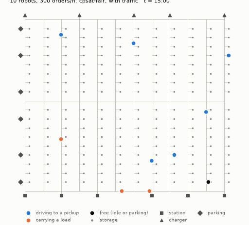
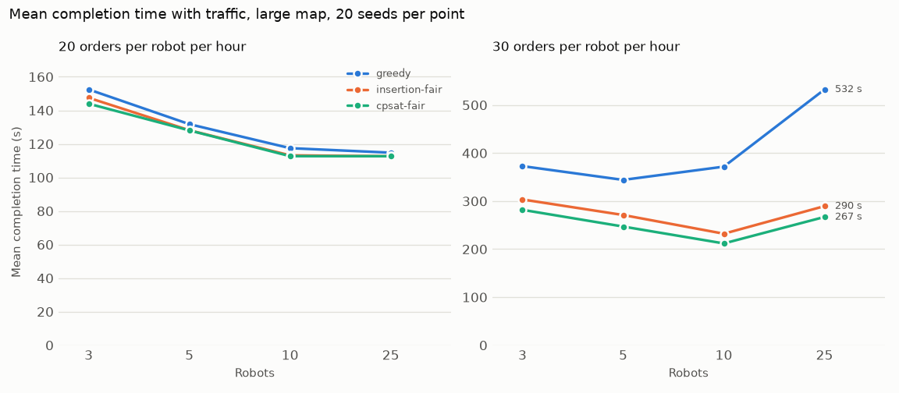
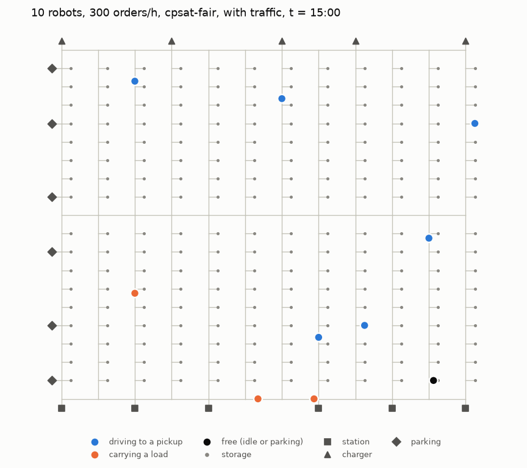

# AMR Fleet Optimization Engine

[](https://github.com/Ramiii18/amr-fleet-optimization-engine/actions/workflows/ci.yml)

A Python engine that dispatches transport orders to a fleet of autonomous mobile robots (AMRs),
plans collision-free routes for them on a warehouse graph, and measures the result in a
reproducible discrete-event simulation.



*Two minutes of a simulated run: 10 robots, 300 orders per hour, the `cpsat-fair` dispatcher, with
traffic. Blue robots are driving to a pickup, orange ones carry a load, and black ones are free.*

> Everything runs on synthetic maps and synthetic orders. This is a portfolio and learning project:
> it does not control physical robots, has not been deployed in any real fleet, and is not a safety
> system. Milestones M1 to M5 and Phase 2's P1 (delays), P2 (batteries and charging) and P3
> (breakdowns and replanning) are complete; see the [roadmap](docs/ROADMAP.md).

## Results at a glance

All numbers come from committed scripts. Each comparison runs every policy on the same 20
seeded scenarios and reports paired differences with 95% confidence intervals
([benchmarks](docs/benchmarks.md)).

| Finding | Evidence |
|---|---|
| **No collisions with traffic management** | 0 conflicts in all 1,840 benchmark runs with traffic management (M4, M5, P1 with ordered execution, P2, P3), checked by an independent checker. The same scenarios in free flow average 61 to 554 conflicts per run, depending on fleet size and load. |
| **Planning beats greedy dispatch as fleets grow** | At 25 robots and 750 orders/h, mean completion time is 267 s with `cpsat-fair` against 532 s with greedy, and the worst case 496 s against 1,050 s. |
| **Optimizing the same decision bought nothing** | Optimal matching (Hungarian) equals greedy when dispatching at every event, because almost every decision has one robot or one order. The gain came from changing the problem: look-ahead to busy robots and sequencing several orders per robot. |
| **Exact search adds a measurable increment** | CP-SAT beats a cheapest-insertion heuristic *on the same model* at high load. In free flow the lead is 5 to 12 s, tested directly. With traffic it is 20 to 24 s, estimated as the difference between the two policies' leads over greedy. The model provides most of the gain. |
| **Optimizing the mean starved some orders; the fix is an objective, not a solver** | Minimizing total completion time made CP-SAT's worst case 210 s worse than greedy's. A worst-first objective (longest lead time first, then the total) made it 80 to 100 s better instead, keeping 62–80% of the gain in mean (free flow, high load). |
| **Plans stay safe when robots are delayed** | Robots that keep the planned order of robots at every node and corridor had 0 conflicts in 240 runs with random delays. Keeping each robot's own schedule would have caused 149 to 531 per run. Delays cost capacity, steeply under load, and planning matters even more: with 20% of edges delayed, `cpsat-fair` beats greedy by 412 to 984 s of mean completion time. |
| **Charging policy matters, and the best one at moderate load fails at high load** | With synthetic batteries, topping up idle robots cuts mean completion time by 26 s and the worst case by 70 to 75 s at moderate load, against charging only when low. Returning low robots to work as soon as they pass the low threshold looks even better at moderate load. At high load it makes robots thrash: about 200 charging trips per run instead of 11 to 13, and a worst case 520 to 600 s worse, which the mean does not show. |
| **Replanning around breakdowns recovers most of their cost** | Without recovery, 8 to 15 breakdowns per run raise mean completion time by 95 to 902 s, because robots queue behind a broken one. Re-timing every plan, so that new jobs are planned around it, recovers 43% to 86% of that cost. Replanning the delayed robots too recovers 75% to 96%, and cuts the worst case by 216 to 4,953 s. Replanning safely needed re-timing first, to keep execution deadlock-free; a stress test found two subtle bugs before the benchmark ran. |
| **Decisions are fast enough for online use** | Every decision took under 1 s (`cpsat-fair` P95 up to 265 ms at 25 robots); greedy and insertion take a few milliseconds. Measured on a laptop. |

<picture>
  <source media="(prefers-color-scheme: dark)" srcset="docs/figures/scaling-dark.png">
  
</picture>

## What's inside

| Area | What it does | Key ideas |
|---|---|---|
| **Warehouse and routing** (`warehouse/`, `routing/`) | Validated directed graphs, a synthetic grid generator with one-way aisles and dead-end spurs, JSON maps | Dijkstra, A* with consistent heuristics, blocked edges |
| **Simulation** (`domain/`, `scenario/`, `sim/`) | Seeded order streams, an explicit robot state machine, a discrete-event simulator with invariant checks after every tick; batteries, shared chargers and three charging policies | Integer time in 0.1 s ticks, pure-function dispatch interface, common random numbers across policies; integer energy, a safety threshold derived from the map, hysteresis |
| **Dispatch** (`dispatch/`) | Greedy; optimal matching; receding-horizon planning of every robot and the oldest 10 orders, by cheapest insertion or CP-SAT | Linear assignment (scipy); CP-SAT giant-tour circuit with symmetry breaking and a deterministic time limit; lexicographic worst-first objective |
| **Traffic** (`traffic/`) | One robot per node and per corridor; each job planned as one timed path; robots park on free dead-end spots; under random delays, plans are executed in the planned order of robots; after a breakdown, plans are re-timed and delayed robots replanned | Safe-interval path planning (SIPP), reservation tables, prioritized planning, completeness on well-formed layouts, deadlock-free ordered execution (temporal plan graph), re-timing as a longest path from a mid-run state |
| **Evaluation** (`metrics/`, `viz/`) | KPIs from the event log, conflict counts from trajectories, paired statistics, figures and animation | Nearest-rank percentiles, t confidence intervals, colour-vision-safe palette |

The [algorithms guide](docs/algorithms.md) explains each component: the problem, the approach, its
complexity, why it is correct, and its limits. It ends with interview-style questions and answers.
The reasoning behind each design choice is recorded in [decisions](docs/DECISIONS.md).

<picture>
  <source media="(prefers-color-scheme: dark)" srcset="docs/figures/map-dark.png">
  
</picture>

## How it is verified

- **Oracles.** Dijkstra and A* are checked against NetworkX. CP-SAT is checked against a brute-force
  search over every plan, and SIPP against a brute-force search over every (node, tick) state.
- **An independent conflict checker** examines every recorded trajectory. It shares nothing with the
  planner except the definition of occupancy, and it is not trivially silent: in free flow it finds
  hundreds of conflicts per run.
- **Hand-derived timelines.** Head-on crossings, station contention, robots moving out of each
  other's way, and look-ahead decisions are each checked tick for tick against timelines computed by
  hand.
- **Invariants** in the state machine and the simulator stop a run with an error, instead of producing
  quietly wrong KPIs.
- **Reproducibility.** Every run is deterministic, a pinned scenario is checked on Windows and Linux
  in CI, and earlier benchmark tables reproduce exactly after later changes.
- **Checks on every commit:** over 1,400 tests, ruff, and mypy in strict mode.

## Quick start

Requires Python 3.13 and Git (Windows PowerShell shown; on Linux or macOS use `python3.13 -m venv
.venv` and `.venv/bin/python`).

```powershell
git clone https://github.com/Ramiii18/amr-fleet-optimization-engine.git
cd amr-fleet-optimization-engine
py -3.13 -m venv .venv
.venv\Scripts\python.exe -m pip install -e ".[dev,viz]"

.venv\Scripts\amr-sim.exe --map large --robots 10 --orders-per-hour 300 --policy cpsat-fair --traffic
.venv\Scripts\amr-sim.exe --map large --robots 10 --orders-per-hour 200 --policy cpsat-fair --traffic --charging opportunistic
.venv\Scripts\amr-sim.exe --help   # every option; --json prints the KPIs as JSON
```

## Reproducing every number

| Result | Command (`.venv\Scripts\python.exe scripts\...`) | Run time on the development laptop | Recorded in |
|---|---|---:|---|
| Dijkstra vs A* | `compare_routing.py` | about 1 s | [benchmarks](docs/benchmarks.md#routing-dijkstra-vs-a-m1-re-run-2026-11-04) |
| Greedy vs optimal matching | `compare_dispatch.py` | about 25 s | [benchmarks](docs/benchmarks.md#dispatch-greedy-vs-optimal-assignment-in-simulation-m2-2026-11-04) |
| Insertion and CP-SAT planning | `compare_planning.py` | about 2–5 min | [benchmarks](docs/benchmarks.md#planning-with-the-worst-first-objective-m35-2026-11-05) |
| Free flow vs traffic | `compare_traffic.py` | about 2.5 min | [benchmarks](docs/benchmarks.md#traffic-the-cost-of-congestion-m4-2026-11-05) |
| Scaling, 3 to 25 robots | `benchmark_scaling.py --csv docs/results/scaling.csv` | about 8.5 min | [benchmarks](docs/benchmarks.md#scaling-with-traffic-3-to-25-robots-m5-2026-11-05) |
| Delays and robust execution | `compare_delays.py` | about 10 min | [benchmarks](docs/benchmarks.md#delays-robust-execution-and-its-cost-phase-2-p1-2026-11-05) |
| Batteries and charging policies | `compare_charging.py` | about 6 min | [benchmarks](docs/benchmarks.md#batteries-and-charging-policies-phase-2-p2-2026-11-05) |
| Breakdowns and replanning | `compare_breakdowns.py` | about 16.5 min | [benchmarks](docs/benchmarks.md#breakdowns-re-timing-and-replanning-phase-2-p3-2026-11-06) |
| Figures and animation | `make_figures.py` | about 25 s | [docs/figures](docs/figures/) |

The comparison scripts run in parallel worker processes (`--jobs`, default 8). The KPIs don't depend
on the machine or on parallelism. Run times and decision latencies do.

The four checks run before every commit:

```powershell
.venv\Scripts\python.exe -m pytest
.venv\Scripts\python.exe -m ruff check .
.venv\Scripts\python.exe -m ruff format --check .
.venv\Scripts\python.exe -m mypy
```

## Limitations

In short:
- robots are points on a graph, with no physics or footprint;
- the traffic model is conservative; delays are survived by keeping the planned order, not by
  replanning;
- prioritized planning is not fleet-optimal;
- batteries are synthetic, and charging follows simple threshold rules;
- breakdowns are announced with their exact repair time, and closed aisles are not modelled;
- everything was evaluated on one synthetic map with uniform demand.

The full list is in [docs/LIMITATIONS.md](docs/LIMITATIONS.md).

## Documentation

- [Project overview](docs/PROJECT_OVERVIEW.md): goals, scope and constraints
- [Algorithms](docs/algorithms.md): how each algorithm works, why it is correct, and its limits
- [Benchmarks](docs/benchmarks.md): every measured result, reported as run
- [Decisions](docs/DECISIONS.md): design decisions and their reasons
- [Architecture](docs/ARCHITECTURE.md): modules, dependencies and modelling assumptions
- [Limitations](docs/LIMITATIONS.md): what the engine does not model or prove
- [Roadmap](docs/ROADMAP.md): milestones, acceptance criteria and the Phase 2 backlog
- [Progress log](docs/LEARNING_PROGRESS.md): what was built and verified, by session

## License

[MIT](LICENSE)
