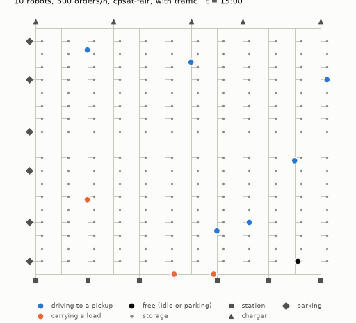
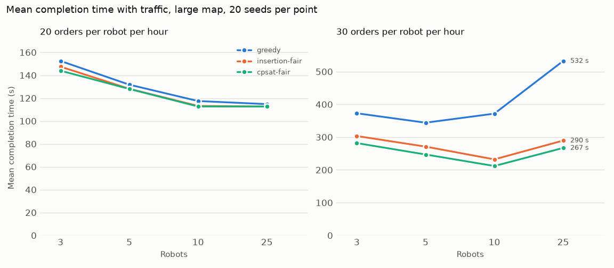
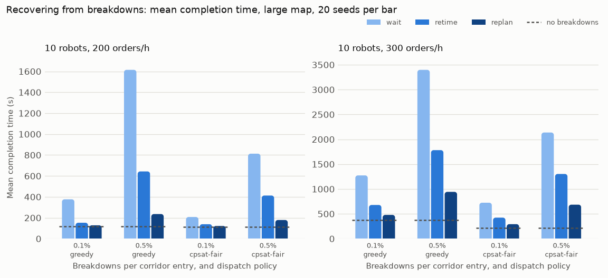
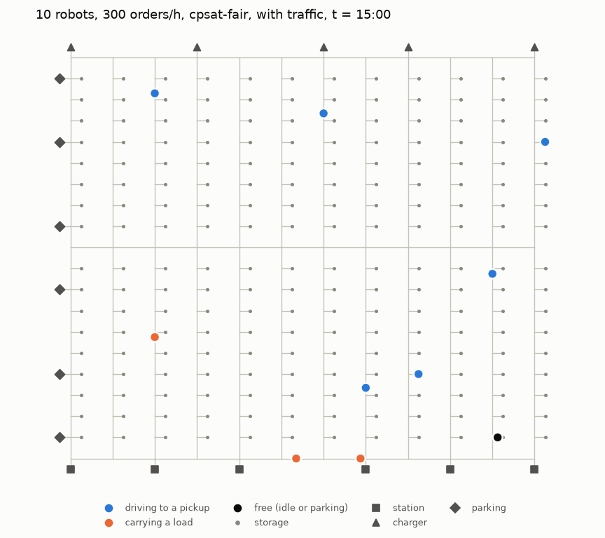
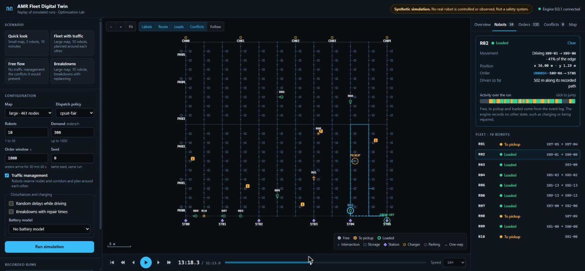

# AMR Fleet Optimization Engine

[](https://github.com/Ramiii18/amr-fleet-optimization-engine/actions/workflows/ci.yml)

A Python engine that dispatches transport orders to a fleet of autonomous mobile robots (AMRs),
plans collision-free routes for them on a warehouse graph, and measures the result in a
reproducible discrete-event simulation. It also serves dispatch decisions over HTTP, sends its
plans to mock robots through the VDA 5050 interface, and replays its simulated runs in a browser
([the viewer](#the-viewer-replaying-a-run-in-the-browser)).



*Two minutes of a simulated run: 10 robots, 300 orders per hour, the `cpsat-fair` dispatcher, with
traffic. Blue robots are driving to a pickup, orange ones carry a load, and black ones are free.*

> Everything runs on synthetic maps and synthetic orders. This is a portfolio and learning project:
> it does not control physical robots (the VDA 5050 robots are mocks), has not been deployed in any
> real fleet, and is not a safety system. Milestones M1 to M5 and Phase 2 (P1 delays, P2 batteries and charging, P3 breakdowns and
> replanning, P4 an HTTP service, P5 a VDA 5050-shaped adapter) are complete, and so are the digital
> twin (replay viewer, experiment lab) and Phase 3 (layouts from floor plans); see the
> [roadmap](docs/ROADMAP.md). Every layout and floor plan in this repository is synthetic.

## Results at a glance

All numbers come from committed scripts. Each comparison runs every policy on the same 20
seeded scenarios and reports paired differences with 95% confidence intervals
([benchmarks](docs/benchmarks.md)).

| Finding | Evidence |
|---|---|
| **No collisions with traffic management** | 0 conflicts in all 1,840 benchmark runs with traffic management (M4, M5, P1 with ordered execution, P2, P3), checked by an independent checker. The same scenarios in free flow average 61 to 554 conflicts per run, depending on fleet size and load. |
| **Planning beats greedy dispatch as fleets grow** | At 25 robots and 750 orders/h, mean completion time is 267 s with `cpsat-fair` against 532 s with greedy, and the mean per-run worst case 496 s against 1,050 s. |
| **Optimizing the same decision bought nothing** | Optimal matching (Hungarian) equals greedy when dispatching at every event, because almost every decision has one robot or one order. The gain came from changing the problem: look-ahead to busy robots and sequencing several orders per robot. |
| **Exact search adds a measurable increment** | CP-SAT beats a cheapest-insertion heuristic *on the same model* at high load. In free flow the lead is 5 to 12 s, tested directly. With traffic it is 20 to 24 s, tested directly by pairing seeds. The model provides most of the gain. |
| **Optimizing the mean starved some orders; the fix is an objective, not a solver** | Minimizing total completion time made CP-SAT's mean per-run worst case 210 s worse than greedy's. A worst-first objective (longest lead time first, then the total) made it 80 to 100 s better instead, keeping 62–80% of the gain in mean (free flow, high load). |
| **Plans stay safe when robots are delayed** | Robots that keep the planned order of robots at every node and corridor had 0 conflicts in 240 runs with random delays. Keeping each robot's own schedule would have caused 149 to 531 per run. Delays cost capacity, steeply under load, and planning matters even more: with 20% of edges delayed, `cpsat-fair` beats greedy by 412 to 984 s of mean completion time. |
| **Charging policy matters, and the best one at moderate load fails at high load** | With synthetic batteries, topping up idle robots cuts mean completion time by 26 s and the mean per-run worst case by 70 to 75 s at moderate load, against charging only when low. Returning low robots to work as soon as they pass the low threshold looks even better at moderate load. At high load it makes robots thrash: about 200 charging trips per run instead of 11 to 13, and a mean per-run worst case 520 to 600 s worse, which the mean does not show. |
| **Replanning around breakdowns recovers most of their cost** | Without recovery, 8 to 15 breakdowns per run raise mean completion time by 95 to 902 s, because robots queue behind a broken one. Re-timing every plan, so that new jobs are planned around it, recovers 43% to 86% of that cost. Replanning the delayed robots too recovers 75% to 96% (bootstrap intervals in the benchmarks), and cuts the mean per-run worst case by 216 to 4,953 s. Replanning safely needed re-timing first, to keep execution deadlock-free; a stress test found two subtle bugs before the benchmark ran. |
| **The plans speak the industry's robot interface** | The engine's plans run on mock robots through VDA 5050 3.0.0 orders and state messages. Every message validates against the specification's official schemas. Fleet control releases each robot's route under the planned order of robots and knows robots only from their reports. Over 800 jobs: zero conflicts, every job delivered, 0.6 to 8.5 s later than planned on average, because robots may stop only at nodes. An external review found a deadlock on a ring of robots waiting for each other; it is fixed and kept as a test. |
| **A cheap layout proxy picked a good station placement, but mostly could not be told apart** | On a synthetic 40 x 30 m hall, a free-flow proxy clustered four stations mid-dock. In a pre-registered study (20 seeds, 12 primary tests, Holm), that placement beat a spread control by 5.0 s and a hand-made baseline by 6.0 s at moderate load with greedy dispatch; the other nine tests were inconclusive, and it never lost on mean completion time ([layout study](docs/LAYOUT_STUDY.md)). |
| **Decisions are fast enough for online use** | Every decision took under 1 s (`cpsat-fair` P95 up to 265 ms at 25 robots); greedy and insertion take a few milliseconds. Measured on a laptop. |

<picture>
  <source media="(prefers-color-scheme: dark)" srcset="docs/figures/scaling-dark.png">
  
</picture>

<picture>
  <source media="(prefers-color-scheme: dark)" srcset="docs/figures/recovery-dark.png">
  
</picture>

## What's inside

| Area | What it does | Key ideas |
|---|---|---|
| **Warehouse and routing** (`warehouse/`, `routing/`) | Validated directed graphs, a synthetic grid generator with one-way aisles and dead-end spurs, JSON maps | Dijkstra, A* with consistent heuristics, blocked edges |
| **Simulation** (`domain/`, `scenario/`, `sim/`) | Seeded order streams, an explicit robot state machine, a discrete-event simulator with invariant checks after every tick; batteries, shared chargers and three charging policies | Integer time in 0.1 s ticks, pure-function dispatch interface, common random numbers across policies; integer energy, a safety threshold derived from the map, hysteresis |
| **Dispatch** (`dispatch/`) | Greedy; optimal matching; receding-horizon planning of every robot and the oldest 10 orders, by cheapest insertion or CP-SAT | Linear assignment (scipy); CP-SAT giant-tour circuit with symmetry breaking and a deterministic time limit; lexicographic worst-first objective |
| **Traffic** (`traffic/`) | One robot per node and per corridor; each job planned as one timed path; robots park on free dead-end spots; under random delays, plans are executed in the planned order of robots; after a breakdown, plans are re-timed and delayed robots replanned | Safe-interval path planning (SIPP), reservation tables, prioritized planning, completeness on well-formed layouts, deadlock-free ordered execution (temporal plan graph), re-timing as a longest path from a mid-run state |
| **Robot interface** (`vda5050/`) | VDA 5050 3.0.0 orders, states and updates; mock robots; fleet control that releases bases under the planned order | Base and horizon as ordered execution, the official JSON schemas as the test oracle |
| **Service** (`api/`) | An HTTP API for dispatch decisions and background simulation jobs, with a Dockerfile | FastAPI with Pydantic at the boundary only, a process pool for CPU-bound work, bounded queues |
| **Replay** (`replay/`, `web/`) | A versioned trace of a finished run, served by the API and written by the CLI; a browser viewer that plays it back | Lossless visits instead of frames, strict validation in Python and TypeScript, golden fixtures as a cross-language oracle, bounded storage |
| **Layouts** (`layout/`) | Floor plans as text grids compiled into the map; a checker that refuses maps the traffic planner cannot handle; static screening of station and charger placements | One node per cell, arrows that constrain their own axis, strongly connected components (iterative Tarjan), a holding-spot bound derived from the code, a separable station proxy and a CP-SAT p-median |
| **Experiments** (`lab/`) | Paired comparisons of policies or layouts over seeds, from experiment files | Fingerprints and pairing keys, t and bootstrap intervals, Holm over pre-registered tests, equivalence margins |
| **Evaluation** (`metrics/`, `viz/`) | KPIs from the event log, conflict counts from trajectories, paired statistics, figures and animation | Nearest-rank percentiles, t confidence intervals, colour-vision-safe palette |

The [algorithms guide](docs/algorithms.md) explains each component: the problem, the approach, its
complexity, why it is correct, and its limits. It ends with interview-style questions and answers.
The reasoning behind each design choice is recorded in [decisions](docs/DECISIONS.md).

<picture>
  <source media="(prefers-color-scheme: dark)" srcset="docs/figures/map-dark.png">
  
</picture>

## How it is verified

- **Oracles.** Dijkstra and A* are checked against NetworkX. CP-SAT is checked against a brute-force
  search over every plan, and SIPP against a brute-force search over every (node, tick) state.
- **An independent conflict checker** examines every recorded trajectory. It shares nothing with the
  planner except the definition of occupancy, and it is not trivially silent: in free flow it finds
  hundreds of conflicts per run.
- **Hand-derived timelines.** Head-on crossings, station contention, robots moving out of each
  other's way, and look-ahead decisions are each checked tick for tick against timelines computed by
  hand.
- **Invariants** in the state machine and the simulator stop a run with an error, instead of producing
  quietly wrong KPIs.
- **The specification as oracle.** Every VDA 5050 message is validated against the specification's
  official JSON schemas, not against this project's own types.
- **Stress runs and review as bug finders.** Bugs that stress runs, larger demos and an external
  review found are kept as regression tests, each shown to fail without its fix. There are seven so
  far, all documented in the decisions and the algorithms guide:
  - two in replanning;
  - four in the VDA 5050 fleet control, among them a deadlock;
  - one in traffic control: put-away orders ending where a robot was parked.
- **Reproducibility.** Every run is deterministic, a pinned scenario is checked on Windows and Linux
  in CI, and earlier benchmark tables reproduce exactly after later changes.
- **The viewer is checked against Python.** Its interpolation must reproduce positions and
  activities that the Python reference computed on three real runs, exactly. A Python test fails if
  those committed fixtures go stale.
- **Observation without interference.** Recording robot events changes no run: the older trace
  fixtures still come out byte for byte, and `scripts/check_published_results.py` re-runs published
  benchmark rows and compares every KPI with the committed results.
- **Checks on every commit:** over 2,300 Python tests, ruff, and mypy in strict mode; 194 viewer
  tests, ESLint and the TypeScript compiler in strict mode; and a Docker build in CI.

## Quick start

Requires Python 3.13 and Git (Windows PowerShell shown; on Linux or macOS use `python3.13 -m venv
.venv` and `.venv/bin/python`).

```powershell
git clone https://github.com/Ramiii18/amr-fleet-optimization-engine.git
cd amr-fleet-optimization-engine
py -3.13 -m venv .venv
.venv\Scripts\python.exe -m pip install -e ".[dev,viz,api]"

.venv\Scripts\amr-sim.exe --map large --robots 10 --orders-per-hour 300 --policy cpsat-fair --traffic
.venv\Scripts\amr-sim.exe --map large --robots 10 --orders-per-hour 200 --policy cpsat-fair --traffic --charging opportunistic
.venv\Scripts\amr-sim.exe --help   # every option; --json prints the KPIs as JSON
.venv\Scripts\amr-api.exe          # the HTTP service; API docs at http://127.0.0.1:8000/docs
```

## Your own scenarios

A scenario file gives the engine your own map, robots and orders. The
[example](scenarios/examples/morning_wave.json) has three robots on the small map, a wave of eight
orders at the start, then one every 20 s:

```json
{"format": "amr-scenario", "version": 1, "map": "small",
 "robots": [{"id": "R1", "node": "PK00"}, {"id": "R2", "node": "PK01"}, ...],
 "orders": [{"id": "O01", "pickup": "S00-01", "dropoff": "ST00", "release_s": 0}, ...]}
```

```powershell
.venv\Scripts\amr-sim.exe --scenario scenarios\examples\morning_wave.json --policy cpsat-fair --traffic
```

- `map` is a preset name, the path of a map file (relative to the scenario file), or a map
  written inline in the [map format](src/amr_optimizer/warehouse/io.py).
- `tick_s`, `speed_mps`, `load_s`, `unload_s` and `description` are optional. Times are in seconds.
- Every other option (policy, traffic, delays, charging, `--json`) works as for generated
  scenarios. The format and its rules are in [D32](docs/DECISIONS.md).

`--timeline out.csv` also writes one row per order, for scenario files and generated scenarios
alike: its robot, the time of each step, its waiting and completion times, and its distances.
`--trace run.json` writes the run's replay trace: everything needed to play the run back.

```text
order,robot,pickup,dropoff,released_s,assigned_s,pickup_reached_s,loaded_s,dropoff_reached_s,delivered_s,waiting_s,completion_s,empty_m,loaded_m
O01,R3,S00-01,ST00,0.0,104.0,106.0,116.0,144.0,154.0,106.0,154.0,2.0,28.0
O02,R3,S01-03,ST01,0.0,0.0,6.0,16.0,32.0,42.0,6.0,42.0,6.0,16.0
```

## The service

`amr-api` serves the engine over HTTP (FastAPI, [D29](docs/DECISIONS.md)). Interactive documentation is
at `/docs`.

| Endpoint | What it does |
|---|---|
| `GET /health`, `/maps`, `/maps/{name}`, `/policies` | Version, preset maps with their nodes and directed edges, dispatch policies |
| `POST /plan` | One dispatch decision. The client sends a fleet snapshot (idle robots, busy robots free at a node from a tick, pending orders) and gets the policy's assignments back. |
| `POST /simulations`, `GET /simulations/{id}` | A whole simulated run in the background. The first call answers 202 with a job id; the second gives the job's status and, when it is done, its KPIs. |
| `GET /simulations/{id}/trace` | The run's replay trace, for jobs submitted with `"record_trace": true`: the map, every robot's recorded visits, the orders, the event log, the KPIs and the conflicts ([D33](docs/DECISIONS.md)). Sent in gzip to clients that accept it. |

- **No CPU-bound work on the event loop.** Every decision and every run happens in worker processes.
- **Bounded input.** Requests are validated and bounded, and errors are 4xx answers with a reason.
- **A local demonstration.** The server binds to 127.0.0.1 and has no authentication.
- **Replay traces are bounded.** The service keeps the traces of the 20 most recent jobs that
  recorded one, within 32 MB of compressed data. The viewer below replays them
  ([digital twin plan](docs/DIGITAL_TWIN_PLAN.md)).

As a container (Docker Desktop on Windows needs WSL2). The CI workflow builds this image on Linux,
starts it, and checks that it answers:

```powershell
docker build -t amr-engine .
docker run --rm -p 127.0.0.1:8000:8000 amr-engine
```

## The viewer: replaying a run in the browser



*A recorded run of 10 robots under `cpsat-fair` with traffic, paused at 13:18. Robot R02 is selected:
its path of the last minute, the recorded path to its drop-off, and its activity over the run.*

`web/` is a browser viewer for runs the engine has simulated (React, TypeScript, a 2D canvas;
[D33, D34](docs/DECISIONS.md)). It is a **replay of finished, synthetic runs**: it simulates nothing,
controls nothing, and shows only what the run's trace contains.

```powershell
.\scripts\dev.ps1        # starts the service and the viewer, and opens http://127.0.0.1:5173
```

The first run needs Node.js (LTS) installed; the script installs the viewer's packages. To start
the two parts by hand:

```powershell
.venv\Scripts\amr-api.exe                 # the engine's service, on http://127.0.0.1:8000
cd web; npm ci; npm run dev               # the viewer, on http://127.0.0.1:5173
```

- **Map.** The warehouse as the graph it is: nodes by kind, connections with their direction
  (one-way connections carry an arrow), pan, zoom, fit, and a scale bar in metres.
- **Run.** Choose map, policy, fleet, demand, seed, traffic, delays, breakdowns and charging. The
  form takes its limits from the service; the service simulates the run and records its trace.
- **Playback.** Play, pause, speed, scrub, step by a second or a tick, jump between logged events.
  Positions are interpolated from recorded visits exactly as the Python reference does; the tests
  reproduce positions, statuses and battery levels computed by Python, bit for bit, on seven
  fixture traces.
- **Details.** A robot's movement, order and recorded path; each order's six logged steps; the
  run's KPIs as the engine computed them; and the conflicts its independent checker found, on the
  map and on the timeline.
- **Robot status and battery.** Charging, out of service, waiting for a charger, breakdown and
  delay traversals, and waits at the end of a corridor, each from an event the simulator recorded
  ([D35](docs/DECISIONS.md)). A battery value is labelled as an engine reading with its age, or as a
  calculation by the engine's charging formula.
- **What it does not show.** Where on an edge a delayed or broken robot is, and a battery level
  between two nodes: the model has neither, so nothing is drawn for them
  ([limitations](docs/LIMITATIONS.md)).

`amr-sim --trace run.json` writes a run's trace to a file, which the viewer opens without the
service.

## The experiment lab: comparing policies over seeds

One run is one draw. The lab runs every policy on every seed of an experiment file and reports
paired differences with intervals, with the primary KPI and the margin for "equivalent" fixed in
the file before the runs.

```powershell
.venv\Scripts\python.exe -m amr_optimizer.lab experiments\dispatch_disturbed.json --workers 8 --out results.json
```

- **Same conditions, checked.** Each run carries a fingerprint of its orders, start positions and
  disturbances; runs of one seed are compared only if their fingerprints are equal.
- **Two disturbance models.** Draws at each corridor entry (the default everywhere else), or a
  schedule of delay episodes and breakdowns fixed before the run (`--model`).
- **Result so far** (20 seeds, two families): `insertion-fair` beats greedy on mean completion
  time under both models. The schedule did not make the comparison more precise, which is
  reported as measured ([algorithms, section 20](docs/algorithms.md); D36 in
  [decisions](docs/DECISIONS.md)).
- Results are a JSON file and a Markdown table. The viewer opens the JSON file (**Experiment
  results…**) and shows each difference with its interval, zero and the margin on one axis. It
  shows the file's figures and computes none.

## Your own layout

A layout file describes a floor plan as a text grid, one character per square metre: `#` blocked,
`.` floor, arrows for one-way floor, `S` storage, `T` station, `C` charger, `P` parking, `?` a
candidate position ([format and rules](docs/LAYOUT_FROM_FLOOR_PLAN.md), D38). Examples are in
[`layouts/examples/`](layouts/examples/).

```powershell
.venv\Scripts\python.exe -m amr_optimizer.layout check layouts\examples\l_hall.layout.json --robots 8
.venv\Scripts\amr-sim.exe --map layouts\examples\l_hall.layout.json --robots 8 --traffic
```

- **Checked before it runs.** With traffic, a map is refused unless every endpoint is a dead end,
  every place is reachable from every other, and there are enough holding spots for the fleet
  (3N − 1 for N robots), with every violation named (D39).
- **From a picture.** A documented procedure turns a floor plan image into a layout file, checked
  by rendering the map over the plan (`scripts/render_layout.py`). It was measured blind on
  synthetic plans only: exact on three clean ones, and on two of three degraded ones; the third had
  6 wrong cells of 182 (D42). A transcription is an approximation, to be confirmed by a person.
- **Where should stations go?** `python -m amr_optimizer.layout screen` ranks candidate slots by a
  free-flow proxy and writes candidate layouts and a lab experiment (D43). The lab compares
  layouts by seed (D41). On one synthetic hall, a pre-registered study found the proxy's choice
  better than both controls in one of four conditions and inconclusive in the others
  ([layout study](docs/LAYOUT_STUDY.md)).
- **Real plans stay private:** `layouts/private/` is git-ignored, and nothing from a real site is
  committed.

## Reproducing every number
| Result | Command (`.venv\Scripts\python.exe scripts\...`) | Run time on the development laptop | Recorded in |
|---|---|---:|---|
| Dijkstra vs A* | `compare_routing.py` | about 1 s | [benchmarks](docs/benchmarks.md#routing-dijkstra-vs-a-m1-re-run-2026-11-04) |
| Greedy vs optimal matching | `compare_dispatch.py` | about 25 s | [benchmarks](docs/benchmarks.md#dispatch-greedy-vs-optimal-assignment-in-simulation-m2-2026-11-04) |
| Insertion and CP-SAT planning | `compare_planning.py` | about 2–5 min | [benchmarks](docs/benchmarks.md#planning-with-the-worst-first-objective-m35-2026-11-05) |
| Free flow vs traffic | `compare_traffic.py` | about 2.5 min | [benchmarks](docs/benchmarks.md#traffic-the-cost-of-congestion-m4-2026-11-05) |
| Scaling, 3 to 25 robots | `benchmark_scaling.py --csv docs/results/scaling.csv` | about 8.5 min | [benchmarks](docs/benchmarks.md#scaling-with-traffic-3-to-25-robots-m5-2026-11-05) |
| Delays and robust execution | `compare_delays.py` | about 10 min | [benchmarks](docs/benchmarks.md#delays-robust-execution-and-its-cost-phase-2-p1-2026-11-05) |
| Batteries and charging policies | `compare_charging.py` | about 6 min | [benchmarks](docs/benchmarks.md#batteries-and-charging-policies-phase-2-p2-2026-11-05) |
| Breakdowns and replanning | `compare_breakdowns.py --csv docs/results/breakdowns.csv` | about 16 min | [benchmarks](docs/benchmarks.md#breakdowns-re-timing-and-replanning-phase-2-p3-2026-11-06) |
| Plans through VDA 5050 messages | `vda5050_demo.py` | under 1 min | [benchmarks](docs/benchmarks.md#vda-5050-plans-executed-through-messages-phase-2-p5-2026-11-06) |
| Direct paired contrasts, recovery intervals | `paired_contrasts.py` (reads the committed CSVs) | about 2 s | [benchmarks](docs/benchmarks.md#direct-paired-contrasts-and-recovery-intervals-reanalysis-2026-11-06) |
| Figures and animation | `make_figures.py` | about 25 s | [docs/figures](docs/figures/) |
| Cell size: 1.0 m against 0.5 m | `measure_cell_size.py` | about 8 s | [benchmarks](docs/benchmarks.md) |
| Vision step scores | `score_transcription.py` (per plan) | not timed | [benchmarks](docs/benchmarks.md) |
| Layout study: pilot | `pilot_capacity.py` (command in the study) | about 50 s | [layout study](docs/LAYOUT_STUDY.md) |
| Layout study: runs and tau | `python -m amr_optimizer.lab` on the study's experiment, then `layout_study_tau.py` | about 2 min | [layout study](docs/LAYOUT_STUDY.md) |

The comparison scripts run in parallel worker processes (`--jobs`, default 8). The KPIs don't depend
on the machine or on parallelism. Run times and decision latencies do.

The exact package versions the benchmarks used are pinned in `constraints.txt`: install with
`-c constraints.txt` to reproduce them. Deterministic solver limits do not guarantee identical
results after a library upgrade.

The four checks run before every commit:

```powershell
.venv\Scripts\python.exe -m pytest
.venv\Scripts\python.exe -m ruff check .
.venv\Scripts\python.exe -m ruff format --check .
.venv\Scripts\python.exe -m mypy
```

## Limitations

In short:
- robots are points on a graph, with no physics or footprint;
- the traffic model is conservative; delays are survived by keeping the planned order, not by
  replanning;
- prioritized planning is not fleet-optimal;
- batteries are synthetic, and charging follows simple threshold rules;
- breakdowns are announced with their exact repair time, and closed aisles are not modelled;
- the HTTP service is a local demonstration: no authentication, and jobs live in memory;
- the VDA 5050 adapter is a mock: no broker, no real robots, one job per robot;
- everything was evaluated on a few synthetic maps with uniform demand;
- layouts are grids of 1 m cells, and reading a floor plan was measured on synthetic plans only.

The full list is in [docs/LIMITATIONS.md](docs/LIMITATIONS.md).

## Documentation

- [Project overview](docs/PROJECT_OVERVIEW.md): goals, scope and constraints
- [Algorithms](docs/algorithms.md): how each algorithm works, why it is correct, and its limits
- [Benchmarks](docs/benchmarks.md): every measured result, reported as run
- [Decisions](docs/DECISIONS.md): design decisions and their reasons
- [Architecture](docs/ARCHITECTURE.md): modules, dependencies and modelling assumptions
- [Limitations](docs/LIMITATIONS.md): what the engine does not model or prove
- [From a floor plan to a layout](docs/LAYOUT_FROM_FLOOR_PLAN.md): the procedure and the file format
- [Layout study](docs/LAYOUT_STUDY.md): the pre-registration and its results
- [Roadmap](docs/ROADMAP.md): milestones, acceptance criteria and the Phase 2 backlog
- [Progress log](docs/LEARNING_PROGRESS.md): what was built and verified, by session

## License

[MIT](LICENSE)
